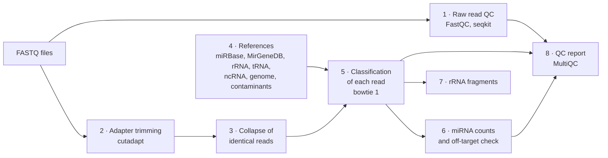

# &nbsp; wf-miRNA-EV

<!-- --8<-- [start:docs] -->
A Snakemake workflow for small RNA sequencing data from extracellular vesicles (EVs). It also accepts whole-cell
libraries, so you can compare EVs with their source cells.

In EV libraries, most reads are often not miRNA but rRNA fragments and contaminant RNA (for example, *Mycoplasma*).
The workflow therefore gives every read one class (miRNA, rRNA, tRNA, other small RNA, genome, contaminant) and flags
miRNAs whose reads match another class equally well.

## What it does



The input is a set of single-end FASTQ files (gzip) and a sample sheet. The off-target check shows the reads that a
miRNA-only mapping would count, but that match another class better.

## Setup

```bash
CONDA_CHANNEL_PRIORITY=strict conda env create -f environment.yaml
conda activate wf-miRNA-EV
```

Snakemake creates the conda environments of the rules at the first run.

Write a sample sheet (TSV) with the columns `sample` and `fastq` (path to the gzipped FASTQ), and optionally `batch`
(sequencing run). Other columns are copied into the summary tables. `config/samples.tsv` is an example. In
`config/config.yaml`, set the sample sheet, the library kit and the references (URLs or local paths).

## Run

```bash
snakemake -n                      # dry run
snakemake --use-conda --cores 8
```

On a SLURM cluster, set the partition in `profiles/slurm/config.yaml`. Create the environments on the login node,
then submit Snakemake as a job. It submits one job for each rule.

```bash
CONDA_CHANNEL_PRIORITY=strict snakemake --profile profiles/slurm --conda-create-envs-only
mkdir -p logs
sbatch --job-name=wf-miRNA-EV --time=2-00:00:00 --mem=4G --output=logs/snakemake_%j.log \
    --wrap "snakemake --profile profiles/slurm"
```

The outputs go to `results/`. The main table is `results/library_summary.tsv`, with one row for each library. The
QC report is `results/report/multiqc_report.html`.

## Use in another Snakemake workflow

Import wf-miRNA-EV as a module in your Snakefile:

```python
configfile: "config/config.yaml"

module wf_mirna_ev:
    snakefile:
        github("katarinagresova/wf-miRNA-EV", path="workflow/Snakefile", tag="v0.1.0")
    config:
        config

# The prefix keeps the rule names apart from yours
use rule * from wf_mirna_ev as wf_mirna_ev_*

rule all:
    input:
        rules.wf_mirna_ev_all.input,
        # your outputs
    default_target: True
```

- The module uses the config that you give it, not `config/config.yaml` of this repository. Copy its settings into
  your config. Relative paths start from the working directory of your workflow.
- Use a release tag. For a local copy, use `snakefile: "path/to/wf-miRNA-EV/workflow/Snakefile"`.
- The outputs go to `results/` of your workflow, so your rules can use them, for example
  `results/mirna/counts_mirbase.tsv`.

## Tests

```bash
pytest tests                                        # unit tests (environment workflow/envs/py.yaml, and pytest)
snakemake --directory .test --use-conda --cores 4   # synthetic test data set
python .test/check.py .test                         # compares the class of each test read with its known class
```

GitHub Actions runs these tests, the lint and a dry run at each push.

<!-- --8<-- [end:docs] -->

## Documentation

- [Configuration](config/README.md): the sample sheet and the config keys
- [Outputs](docs/outputs.md): each output file and its columns
- [Read classification](docs/classification.md): the read classes, the contaminant rules and the off-target check
- [miRNA counts](docs/mirna_counters.md): the counting rules and the counter interface

## License

Apache License 2.0. See [LICENSE](LICENSE).
