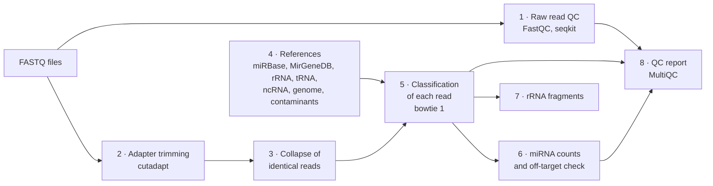

# &nbsp; wf-miRNA-EV

<!-- --8<-- [start:docs] -->
A Snakemake workflow for small RNA sequencing data from extracellular vesicles (EVs). It also accepts whole-cell
libraries, so you can compare EVs with their source cells.

In EV libraries, most reads are often not miRNA but rRNA fragments and contaminant RNA (for example, *Mycoplasma*).
The workflow therefore gives every read one class (miRNA, rRNA, tRNA, other small RNA, genome, contaminant) and flags
miRNAs whose reads match another class equally well.

## What it does



The input is a set of single-end FASTQ files (gzip) and a sample sheet. The off-target check shows the reads that a
miRNA-only mapping would count, but that match another class better.

## Setup

```bash
CONDA_CHANNEL_PRIORITY=strict conda env create -f environment.yaml
conda activate wf-miRNA-EV
```

Snakemake creates the conda environments of the rules at the first run.

Write a sample sheet (TSV) with the columns `sample` and `fastq` (path to the gzipped FASTQ), and optionally `batch`
(sequencing run). Other columns are copied into the summary tables. `config/samples.tsv` is an example. In
`config/config.yaml`, set the sample sheet, the library kit and the references (URLs or local paths).

## Run

```bash
snakemake -n                      # dry run
snakemake --use-conda --cores 8
```

On a SLURM cluster, set the partition in `profiles/slurm/config.yaml`. Create the environments on the login node,
then submit Snakemake as a job. It submits one job for each rule.

```bash
CONDA_CHANNEL_PRIORITY=strict snakemake --profile profiles/slurm --conda-create-envs-only
mkdir -p logs
sbatch --job-name=wf-miRNA-EV --time=2-00:00:00 --mem=4G --output=logs/snakemake_%j.log \
    --wrap "snakemake --profile profiles/slurm"
```

The outputs go to `results/`. The main table is `results/library_summary.tsv`, with one row for each library. The
QC report is `results/report/multiqc_report.html`.

## Use in another Snakemake workflow

Import wf-miRNA-EV as a module in your Snakefile:

```python
configfile: "config/config.yaml"

module wf_mirna_ev:
    snakefile:
        github("katarinagresova/wf-miRNA-EV", path="workflow/Snakefile", tag="v0.1.0")
    config:
        config["wf_mirna_ev"]

# The prefix keeps the rule names apart from yours
use rule * from wf_mirna_ev as wf_mirna_ev_*

rule all:
    input:
        rules.wf_mirna_ev_all.input,
        # your outputs
    default_target: True
```

- The module uses the settings under the key `wf_mirna_ev` of your config, not `config/config.yaml` of this
  repository. Copy its settings to this key. Relative paths start from the working directory of your workflow.
- Use a release tag. For a local copy, use `snakefile: "path/to/wf-miRNA-EV/workflow/Snakefile"`.
- The outputs go to `results/` of your workflow, so your rules can use them, for example
  `results/mirna/counts_mirbase.tsv`.

## Tests

```bash
pytest tests                                        # unit tests (environment workflow/envs/py.yaml, and pytest)
snakemake --directory .test --use-conda --cores 4   # synthetic test data set
python .test/check.py .test                         # compares the class and the miRNA of each test read with the known ones
```

GitHub Actions runs these tests, the lint and a dry run at each push.

## Tools and references

The workflow uses these tools and references. Each item gives the publication that describes it.

Tools:

- [Snakemake](https://snakemake.github.io): Mölder F, et al. Sustainable data analysis with Snakemake.
  *F1000Research* 10, 33 (2021). [doi:10.12688/f1000research.29032.3](https://doi.org/10.12688/f1000research.29032.3)
- [FastQC](https://www.bioinformatics.babraham.ac.uk/projects/fastqc/): Andrews S. FastQC: a quality control tool for
  high throughput sequence data (2010).
- [SeqKit](https://bioinf.shenwei.me/seqkit/): Shen W, Sipos B, Zhao L. SeqKit2: A Swiss army knife for sequence and
  alignment processing. *iMeta* 3, e191 (2024). [doi:10.1002/imt2.191](https://doi.org/10.1002/imt2.191)
- [Cutadapt](https://cutadapt.readthedocs.io): Martin M. Cutadapt removes adapter sequences from high-throughput
  sequencing reads. *EMBnet.journal* 17, 10–12 (2011).
  [doi:10.14806/ej.17.1.200](https://doi.org/10.14806/ej.17.1.200)
- [Bowtie 1](https://bowtie-bio.sourceforge.net): Langmead B, Trapnell C, Pop M, Salzberg SL. Ultrafast and
  memory-efficient alignment of short DNA sequences to the human genome. *Genome Biology* 10, R25 (2009).
  [doi:10.1186/gb-2009-10-3-r25](https://doi.org/10.1186/gb-2009-10-3-r25)
- [BEDTools](https://bedtools.readthedocs.io): Quinlan AR, Hall IM. BEDTools: a flexible suite of utilities for
  comparing genomic features. *Bioinformatics* 26, 841–842 (2010).
  [doi:10.1093/bioinformatics/btq033](https://doi.org/10.1093/bioinformatics/btq033)
- [MultiQC](https://multiqc.info): Ewels P, Magnusson M, Lundin S, Käller M. MultiQC: summarize analysis results for
  multiple tools and samples in a single report. *Bioinformatics* 32, 3047–3048 (2016).
  [doi:10.1093/bioinformatics/btw354](https://doi.org/10.1093/bioinformatics/btw354)

References:

- [miRBase](https://www.mirbase.org): Kozomara A, Birgaoanu M, Griffiths-Jones S. miRBase: from microRNA sequences to
  function. *Nucleic Acids Research* 47, D155–D162 (2019).
  [doi:10.1093/nar/gky1141](https://doi.org/10.1093/nar/gky1141)
- [MirGeneDB](https://mirgenedb.org): Clarke AW, et al. MirGeneDB 3.0: improved taxonomic sampling, uniform
  nomenclature of novel conserved microRNA families and updated covariance models. *Nucleic Acids Research* 53,
  D116–D128 (2025). [doi:10.1093/nar/gkae1094](https://doi.org/10.1093/nar/gkae1094)
- [GtRNAdb](https://gtrnadb.ucsc.edu): Chan PP, Lowe TM. GtRNAdb 2.0: an expanded database of transfer RNA genes
  identified in complete and draft genomes. *Nucleic Acids Research* 44, D184–D189 (2016).
  [doi:10.1093/nar/gkv1309](https://doi.org/10.1093/nar/gkv1309)
- [Ensembl](https://www.ensembl.org): Dyer SC, et al. Ensembl 2025. *Nucleic Acids Research* 53, D948–D957 (2025).
  [doi:10.1093/nar/gkae1071](https://doi.org/10.1093/nar/gkae1071)
- rDNA repeat [KY962518.1](https://www.ncbi.nlm.nih.gov/nuccore/KY962518.1): Kim JH, et al. Variation in human
  chromosome 21 ribosomal RNA genes characterized by TAR cloning and long-read sequencing. *Nucleic Acids Research*
  46, 6712–6725 (2018). [doi:10.1093/nar/gky442](https://doi.org/10.1093/nar/gky442)

<!-- --8<-- [end:docs] -->

## Documentation

- [Configuration](config/README.md): the sample sheet and the config keys
- [Outputs](docs/outputs.md): each output file and its columns
- [Read classification](docs/classification.md): the read classes, the contaminant rules and the off-target check
- [miRNA counts](docs/mirna_counters.md): the counting rules and the counter interface

## License

Apache License 2.0. See [LICENSE](LICENSE).
